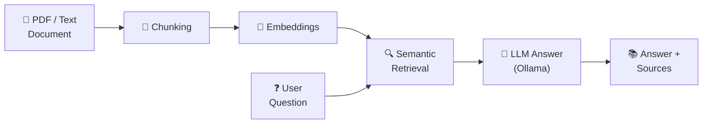

<div align="center">

# Knowledge Hub

### PDF-Based Retrieval-Augmented Generation (RAG) Application

*Turning documents into intelligent, searchable knowledge.*

<br>


<br>

[Overview](#-overview) · [Features](#-features) · [Tech Stack](#-tech-stack) · [Setup](#-installation--setup) · [Pipeline](#-how-the-rag-pipeline-works) · [API](#-api-documentation) · [Roadmap](#-development-roadmap)

</div>

<br>

---

## ✨ Overview

**Knowledge Hub** is a Python-based document processing and Retrieval-Augmented Generation (RAG) application. It lets you retrieve relevant information from your documents and generate context-aware answers using a Large Language Model (LLM).

The project combines **document extraction**, **text chunking**, **semantic embeddings**, **similarity-based retrieval**, and **local AI-powered answer generation**.

Instead of relying only on an LLM's pre-trained knowledge, Knowledge Hub first retrieves relevant information from the documents you supply, and only then generates an answer.

> [!TIP]
> **The goal:** make information stored in documents searchable, accessible, and useful through natural-language questions.

<br>

---

## 🚀 Features

| | Feature | Description |
|:-:|---|---|
| 📤 | **PDF Upload** | Upload PDF documents through a REST API |
| 📄 | **Text Extraction** | Extract text from PDF files using PyPDF |
| 💾 | **Local Storage** | Store uploaded and extracted documents locally |
| 🧩 | **Smart Chunking** | Split documents into smaller, overlapping text chunks |
| 🔢 | **Semantic Embeddings** | Generate embeddings using Sentence Transformers |
| 🔍 | **Semantic Retrieval** | Retrieve relevant chunks using cosine similarity |
| 🤖 | **Local LLM Answers** | Generate context-aware answers through Ollama |
| 📚 | **Source Attribution** | Display source document names and chunk IDs |
| 🎯 | **Relevance Filtering** | Filter irrelevant results using a similarity threshold |
| 🛡️ | **Safe Handling** | Handle errors and out-of-scope questions gracefully |
| ⚡ | **FastAPI Backend** | Interactive Swagger documentation included |
| 📂 | **Multi-Document** | Process multiple text documents from a single data folder |

<br>

---

## 🛠️ Tech Stack

| Category | Technology |
|---|---|
| **Language** | Python |
| **Backend** | FastAPI |
| **PDF Processing** | PyPDF |
| **Text Embeddings** | Sentence Transformers |
| **Embedding Model** | `all-MiniLM-L6-v2` |
| **Numerical Operations** | NumPy |
| **Similarity Search** | Cosine Similarity |
| **Large Language Model** | Qwen 2.5 (1.5B) |
| **LLM Runtime** | Ollama |
| **API Server** | Uvicorn |
| **API Testing** | Swagger UI |
| **File Handling** | Python `pathlib` |

<br>

---

## 📁 Project Structure

```text
Knowledge-Hub/
│
├── app/
│   ├── app.py
│   └── main.py
│
├── data/
│   ├── input.txt
│   ├── Saleem.txt
│   └── RAG_chunks.txt
│
├── make_chunks.py
├── make_embeddings.py
├── retrieve.py
│
├── chunks.json
├── embeddings.npy
│
├── requirements.txt
├── .gitignore
└── README.md
```

> [!NOTE]
> The `data/` folder contains local documents and extracted text. It is excluded from Git tracking to avoid uploading private or personal documents.

> [!IMPORTANT]
> The current chunking script processes `.txt` files inside `data/`. PDF text extraction is supported through the document-processing API, but direct PDF ingestion into the RAG chunking pipeline is a planned improvement.

<br>

---

## ⚙️ Installation & Setup

**1. Clone the repository**

```bash
git clone https://github.com/saleemshabir/Knowledge-Hub-RAG.git
cd Knowledge-Hub-RAG
```

**2. Create a virtual environment**

```bash
python -m venv venv
```

**3. Activate the environment**

```bash
# Windows
venv\Scripts\activate

# macOS / Linux
source venv/bin/activate
```

**4. Install dependencies**

```bash
pip install -r requirements.txt
```

**5. Install and configure Ollama**

Install [Ollama](https://ollama.com/) and download the model:

```bash
ollama pull qwen2.5:1.5b
```

> [!NOTE]
> Make sure Ollama is running before using the RAG question-answering pipeline.

<br>

---

## 🔄 How the RAG Pipeline Works

Knowledge Hub follows a classic Retrieval-Augmented Generation workflow.



### 1 · Document Extraction

PDF documents are uploaded through the FastAPI backend. PyPDF extracts their text, which is stored locally for further processing.

### 2 · Text Chunking

Large text documents are divided into smaller, manageable pieces.

| Parameter | Value |
|---|:-:|
| Chunk size | 500 characters |
| Chunk overlap | 50 characters |

Overlapping chunks help preserve context between consecutive pieces of text. Each chunk also stores metadata such as its unique ID and original source filename.

### 3 · Embedding Generation

The `all-MiniLM-L6-v2` model converts each text chunk into a numerical vector. These embeddings represent the semantic meaning of the text and allow the system to compare questions with document content.

### 4 · Semantic Retrieval

When a user submits a question:

1. The question is converted into an embedding.
2. Cosine similarity measures how closely each document chunk matches the question.
3. The system ranks the results and retrieves the most relevant chunks.
4. A similarity threshold filters out irrelevant results.

### 5 · Answer Generation

The retrieved information is passed as context to the Qwen 2.5 model through Ollama. The model generates an answer based on the retrieved document content.

### 6 · Source Attribution

The application displays the source filenames and chunk IDs used to generate the answer, making the retrieved information easy to trace.

<br>

---

## ▶️ Running the Project

**Step 1: Generate text chunks**

```bash
python make_chunks.py
```

Reads all `.txt` files in the `data/` directory and generates `chunks.json`.

**Step 2: Generate embeddings**

```bash
python make_embeddings.py
```

Converts the generated chunks into embeddings and saves them in `embeddings.npy`.

**Step 3: Run the RAG application**

```bash
python retrieve.py
```

Enter a question when prompted:

```text
Enter your question: What is the purpose of text chunking in a RAG system?
```

The application retrieves relevant chunks and generates an answer using Ollama.

<br>

---

## 📖 API Documentation

The FastAPI backend provides an interface for document uploading and text extraction.

Start the API server from the project root:

```bash
uvicorn app.main_app:app --reload
```

Once the server is running, open Swagger UI at **http://127.0.0.1:8000/docs**

Start the frontend in a second terminal:

```bash
cd frontend
npm install
npm run dev
```

In local development, set the browser-origin configuration before starting the
backend in PowerShell:

```powershell
$env:FRONTEND_ORIGINS = "http://localhost:5173,http://127.0.0.1:5173"
uvicorn app.main_app:app --reload
```

The app supports multiple PDF/TXT/Markdown/CSV/JSON files in one shared document
library. This version has no login or separate accounts: anyone with access to
the app can see, query, and remove files in that library. Do not expose it to
untrusted users or upload private documents to a public deployment.

For a trusted hosted environment, set `FRONTEND_ORIGINS` to the exact frontend
origin and point `KNOWLEDGEHUB_DATABASE_PATH` and `KNOWLEDGEHUB_DATA_DIR` at
persistent storage. Set `VITE_API_URL` to the deployed API URL when building the
frontend. The API host must also be able to reach Ollama; configure `OLLAMA_URL`
and `OLLAMA_MODEL` for the deployment.

| Method | Endpoint | Description |
|:-:|---|---|
| `GET` | `/health` | Check application status |
| `GET` | `/documents` | List the workspace's documents |
| `POST` | `/upload` | Upload multiple supported document files |
| `DELETE` | `/documents/{document_id}` | Remove a workspace document |
| `POST` | `/ask` | Ask a question across the workspace's indexed documents |

<br>

---

## 🧪 Testing & Validation

The core RAG pipeline has been tested with multiple documents and different types of questions.

| Test | Expected Behaviour | Result |
|---|---|:-:|
| Multiple document processing | Process all `.txt` files | ✅ Passed |
| Relevant question | Retrieve matching chunks | ✅ Passed |
| Cross-document retrieval | Retrieve information from different source files | ✅ Passed |
| Source attribution | Display source filename and chunk ID | ✅ Passed |
| Out-of-scope question | Reject irrelevant queries | ✅ Passed |
| Answer generation | Generate answers using retrieved context | ✅ Passed |

### Example Questions

**Relevant question**

```text
Who is Saleem, and what is he currently doing?
```

The system retrieves information from `Saleem.txt` and generates an answer using its content.

**Another relevant question**

```text
What is the purpose of text chunking in a RAG system?
```

The system retrieves information from `RAG_chunks.txt`.

**Out-of-scope question**

```text
What is the capital of Japan?
```

If no relevant chunks meet the similarity threshold, the application responds:

> *I don't know based on the information provided.*

<br>

---

## 🗺️ Development Roadmap

<table>
<tr>
<td valign="top" width="50%">

### ✅ Completed

- [x] FastAPI backend setup
- [x] PDF upload functionality
- [x] PDF text extraction
- [x] Local text storage
- [x] Multi-document text processing
- [x] Text chunking with overlap
- [x] Unique chunk IDs and source metadata
- [x] Embedding generation
- [x] Semantic similarity retrieval
- [x] Top-K relevant chunk selection
- [x] Similarity threshold filtering
- [x] Local LLM integration using Ollama
- [x] Context-aware answer generation
- [x] Source citations
- [x] Out-of-scope query handling
- [x] Basic error handling and validation

</td>
<td valign="top" width="50%">

### 🔮 Future Improvements

- [ ] Direct PDF ingestion into the RAG pipeline
- [ ] Vector database integration
- [ ] Web-based user interface
- [ ] Conversational chat history
- [ ] Improved retrieval and ranking
- [ ] Additional document format support
- [ ] Deployment and cloud hosting

</td>
</tr>
</table>

<br>

---

## 🎯 Future Goals

The next stage of Knowledge Hub is to transform the current backend into a complete **document intelligence application**.

Future development will focus on a user-friendly interface, improved document management, scalable vector storage, and more advanced retrieval techniques.

The long-term goal is to create a system where users can upload their own documents and interact with their knowledge through natural-language conversations.

<br>

---

<div align="center">

### Knowledge Hub

*From documents to knowledge. From questions to answers.*

⭐ If you find this project interesting, consider giving it a star!

</div>
